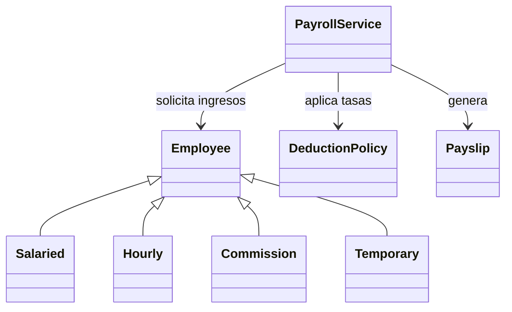

<div align="center">

# Sistema de nómina

### Programación orientada a objetos · Ingeniería de Software

**Universidad de Cartagena · Actividad Unidad 3**

Una solución en Python para calcular salarios, beneficios y deducciones de cuatro modalidades de empleados.


[Informe](documentos/Informe_Unidad_3_Jesus_Davod_Campo.pdf) · [Presentación](presentacion/README.md) · [Código](nomina/domain.py) · [Pruebas](tests/test_payroll.py)

**Jesus Davod Campo** · [@Jesussscy](https://github.com/Jesussscy)

</div>


## Explora la entrega

| Material | Contenido |
| :--- | :--- |
| [Informe académico · PDF](documentos/Informe_Unidad_3_Jesus_Davod_Campo.pdf) | Ocho páginas en blanco y negro: requisitos, diseño, SOLID, metodología y resultados. |
| [Presentación animada · HTML](presentacion/index.html) | Cinco diapositivas con imágenes, animaciones, notas y pantalla completa. |
| [Presentación editable · PowerPoint](presentacion/Presentacion_Nomina_Mejorada.pptx) | Diapositivas con notas del expositor y transiciones de fundido. |
| [Guion de exposición](presentacion/guion_3_4_minutos.md) | Texto organizado por diapositiva para una presentación de tres a cuatro minutos. |
| [Resultados de ejemplo · CSV](evidencia/nomina_ejemplo.csv) | Desglose de ingresos, deducciones, beneficios y costo empresarial. |
| [Registro de pruebas](evidencia/pruebas.txt) | Resultado de la ejecución local de las 25 pruebas unitarias. |
| [Enunciado original](enunciado/ACTIVIDAD_UNIDAD_3.pdf) | Reglas y requisitos de la actividad. |

> **Para presentar:** descarga el repositorio completo y abre `presentacion/index.html` en el navegador. Conserva la carpeta `assets` junto al archivo. Avanza con las flechas o la barra espaciadora y activa la pantalla completa desde los controles.

## Ejecuta el proyecto

Necesitas **Python 3.10 o superior**. La nómina y las pruebas utilizan únicamente la biblioteca estándar.

```bash
git clone https://github.com/tab-Jesus/IngDeSoftware.git
cd IngDeSoftware
python -m nomina
```

Exporta la demostración o ejecuta las pruebas:

```bash
python -m nomina --csv evidencia/nomina_ejemplo.csv
python -m unittest discover -s tests -v
```

## ¿Qué calcula?

| Modalidad | Ingresos | Beneficios |
| :--- | :--- | :--- |
| **Asalariado** | Salario fijo y bono del 10% con más de cinco años de antigüedad. | Alimentación de $1.000.000. |
| **Por horas** | Hasta 40 horas a tarifa normal; exceso a 1,5 veces la tarifa. | Ahorro del 2% con más de un año y aceptación expresa. |
| **Por comisión** | Base más comisión. Bono del 3% sobre ventas si superan $20.000.000. | Alimentación de $1.000.000. |
| **Temporal** | Salario fijo dentro de las fechas del contrato. | Sin bonos ni alimentación adicional. |

El sistema valida los datos, rechaza salarios netos negativos y calcula los importes con `Decimal` y redondeo por concepto.

## Resultados de la demostración

Ejemplos ficticios. Importes expresados en **COP**.

| Modalidad | Salario bruto | Neto al empleado | Costo empresarial modelado |
| :--- | ---: | ---: | ---: |
| Asalariado | $3.300.000 | $3.036.000 | $4.317.226 |
| Por horas | $950.000 | $855.000 | $954.959 |
| Por comisión | $4.000.000 | $3.680.000 | $5.020.880 |
| Temporal | $1.800.000 | $1.656.000 | $1.809.396 |

**Ejemplo por horas:** $800.000 de horas normales + $150.000 de extras − $38.000 de seguro − $38.000 de pensión − $19.000 de ahorro = **$855.000 netos**.

## Diseño del sistema



Cada modalidad calcula sus ingresos mediante el contrato `Employee`. `DeductionPolicy` concentra las tasas y `PayrollService` coordina la liquidación. La consola presenta el resultado y permite exportarlo a CSV.

<details>
<summary><strong>Aplicación de SOLID y refactorización</strong></summary>

| Principio | Aplicación |
| :--- | :--- |
| Responsabilidad única | Entidades para ingresos, política para deducciones y consola para salida. |
| Abierto/cerrado | Nuevas modalidades implementan `Employee` sin condicionales en el servicio. |
| Sustitución de Liskov | Las modalidades respetan el contrato de cálculo y elegibilidad. |
| Segregación de interfaces | El dominio no exige operaciones de interfaz ni persistencia. |
| Inversión de dependencias | El servicio recibe una política y trabaja con el contrato del empleado. |

La refactorización trasladó la validación del período temporal a `validate_period`, eliminando la consulta del tipo concreto en el servicio. El redondeo y las tasas se concentran en operaciones reutilizables.

</details>

<details>
<summary><strong>Supuestos de cálculo</strong></summary>

La guía deja detalles sin especificar. Las decisiones académicas se documentan en el informe:

- Seguro y pensión: 4% del bruto para cada concepto, con tasas configurables.
- ARL: costo empresarial separado y tasa ilustrativa configurable del 0,522%.
- Alimentación: beneficio separado del neto y de la base de deducciones del ejemplo.
- Fondo: retención del 2% del bruto cuando corresponde y el empleado acepta.
- Horas: umbral de 40 en el período ingresado, sin convertir semanas a meses.
- Temporal: fecha dentro del contrato, extremos inclusivos y sin prorrateo.
- Precisión: `Decimal`, dos decimales y redondeo `ROUND_HALF_UP` por concepto.

El costo empresarial incluye únicamente los conceptos modelados en la actividad.

</details>

<details>
<summary><strong>Validación y metodología</strong></summary>

Las **25 pruebas unitarias** cubren oráculos numéricos, límites de las reglas, aceptación del ahorro, fechas, tasas configurables y entradas inválidas. Consulta [el registro de pruebas](evidencia/pruebas.txt).

El desarrollo sigue incrementos de análisis, construcción, verificación y documentación. La revisión de la presentación se registra en [la evidencia de navegación y formato](evidencia/presentacion_qa.txt).

</details>

## Organización del repositorio

```text
IngDeSoftware/
├── nomina/          # Modelo, políticas, servicio y demostración
├── tests/           # Pruebas unitarias
├── documentos/      # Informe académico y guion ampliado
├── presentacion/    # HTML, PowerPoint, imágenes y guion breve
├── evidencia/       # CSV, pruebas y revisión de presentación
├── enunciado/       # Actividad original
└── tools/           # Generación y verificación de materiales
```

Para otros escenarios, crea instancias de las clases de `nomina/domain.py` y utiliza `PayrollService().calculate(empleado, fecha_del_periodo)`.

Los generadores de `tools/` usan dependencias adicionales y rutas del entorno de creación; no son necesarios para ejecutar la nómina. Consulta los [créditos visuales](presentacion/assets/FUENTES.md).

---

<div align="center">

**Jesus Davod Campo** · [@Jesussscy](https://github.com/Jesussscy)  
Ingeniería de Software · Universidad de Cartagena

La publicación del video en YouTube está pendiente. La guía solicita entrega CIPA; la modalidad debe confirmarse con el docente.

</div>
